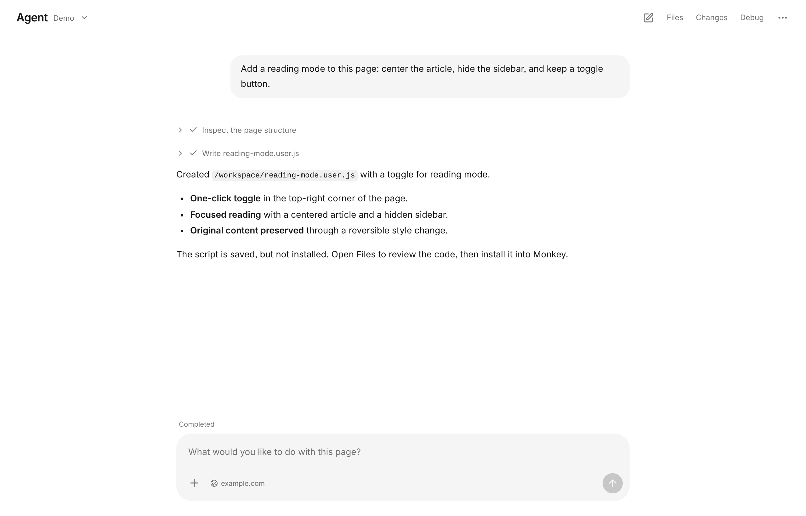
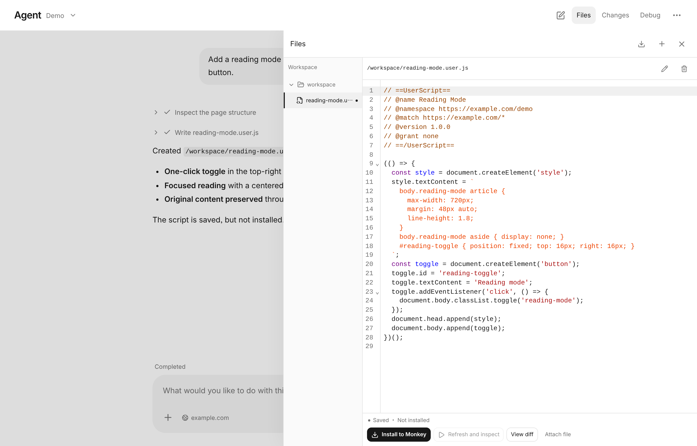
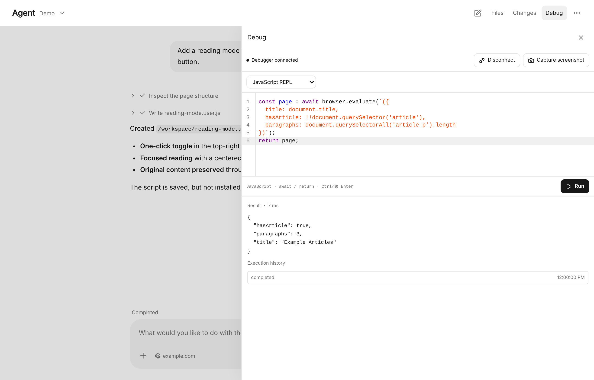

# MonkeyAgent

[English](README.md) | [简体中文](README_CN.md)

Build, install, and debug userscripts through a conversation in your browser's DevTools.

MonkeyAgent is a fork of [Violentmonkey](https://github.com/violentmonkey/violentmonkey) with an **Agent** panel for Chromium. Describe what you want to change on a page, inspect the generated code, install it, and check its behavior against the inspected tab.



_Screenshots show the actual Agent UI in an isolated test extension, using synthetic demo data on `example.com`._

## Features

- **A conversation at the center.** Files, changes, and debugging tools open in separate drawers when you need them. English interface with light and dark themes.
- **Userscript editing and installation.** Create scripts or import existing ones, edit them in CodeMirror, review diffs, and install them into Monkey. Revision checks help prevent concurrent edits from overwriting each other.
- **Debugging against the inspected tab.** Evaluate JavaScript, inspect DOM and browser events, read network responses, capture screenshots, and verify script behavior.
- **Site workspaces with separate sessions.** Pages under the same registrable domain (eTLD+1) share files and session history. Each session keeps its own conversation, run records, and task baseline.
- **Persistent work and explicit control.** Files and messages survive reopening DevTools. Stop a running task, add instructions to its queue, or clear the conversation while keeping your files.

## Getting started

You need **Node.js 24+**, the pnpm version specified in `package.json`, and **Chromium/Chrome 135+**.

From the repository root:

```sh
pnpm install --frozen-lockfile
pnpm build:mv3
```

1. Open `chrome://extensions` and enable **Developer mode**.
2. Choose **Load unpacked** and select the generated `dist-mv3/` directory.
3. Open the extension's details and enable **Allow User Scripts**.
4. Open the page you want to work on, open DevTools, and select **Agent**. The panel may be inside the DevTools overflow menu.
5. Open the model selector at the top left. Configure a Chat Completions compatible endpoint with streaming and tool calling, its model ID, and an API key if required. The base URL usually ends in `/v1`; do not append `/chat/completions`.
6. Describe the page change you want, or import a script from the **Files** drawer.

For example:

> Add a reading mode to this page: center the article, hide the sidebar, and keep a button to toggle it.

The Agent is included in the **MV3 build**. The standard `pnpm build` command produces the upstream-style MV2 extension without the Agent panel.

## Files and changes

The Files drawer keeps the directory tree and editor together. Files save automatically; installation is a separate action. The Changes drawer compares the current file with the task's starting revision or its last installed version, and can restore that baseline as a new revision.



Saving a file does not change the script running on the page. Install the update, then refresh and check its behavior.

## Browser debugging

The Debug drawer provides a JavaScript REPL, logs, network events, and screenshots. Manual commands and Agent tools use the same execution queue, and browser operations remain bound to the inspected tab.



The REPL supports `await`, explicit `return`, and a temporary `state` object. For example:

```js
return await browser.evaluate('document.title');
```

## Workspaces and data

Workspaces follow the site's eTLD+1, including private suffixes: subdomains of `example.com` share a workspace, while different `github.io` tenants remain separate. Creating a session starts a new conversation within the site's existing workspace.

Cross-site navigation stops the current task and switches to the destination site's workspace and sessions. Returning to a site restores the session last used by that inspected tab. Opening the same session in two DevTools windows is prevented; separate sessions can share workspace files.

Files, conversations, and run records are stored locally in the extension. Model requests go to your configured endpoint and can contain conversation text, script content, and page data returned by tools. The API key is stored separately from workspace files and is not added to model prompt text.

## Development

| Command                   | Purpose                                                                       |
| ------------------------- | ----------------------------------------------------------------------------- |
| `pnpm dev:mv3`            | Watch the extension and Agent sources. Reload the extension after rebuilding. |
| `pnpm agent:dev`          | Preview the Agent UI locally. Real browser debugging requires the extension.  |
| `pnpm run ci`             | Run lint, unit tests, and Agent type checks.                                  |
| `pnpm agent:test:browser` | Build MV3 and run the Chromium integration tests.                             |
| `pnpm build`              | Build the upstream-style MV2 extension.                                       |

Before running browser tests for the first time, install the test browser:

```sh
pnpm --filter @monkeyagent/devtools-agent exec playwright install chromium
```

For package setup, tool contracts, and debugging details, see the [DevTools Agent guide](packages/devtools-agent/README.md) and [design document](docs/devtools-agent-design.md), both currently in Chinese.

## Credits and license

MonkeyAgent builds on Violentmonkey's userscript manager. Upstream project information is available in the [Violentmonkey repository](https://github.com/violentmonkey/violentmonkey) and [website](https://violentmonkey.github.io/).

Released under the [MIT license](LICENSE). Agent dependencies and their licenses are listed in [THIRD_PARTY.md](packages/devtools-agent/THIRD_PARTY.md).
