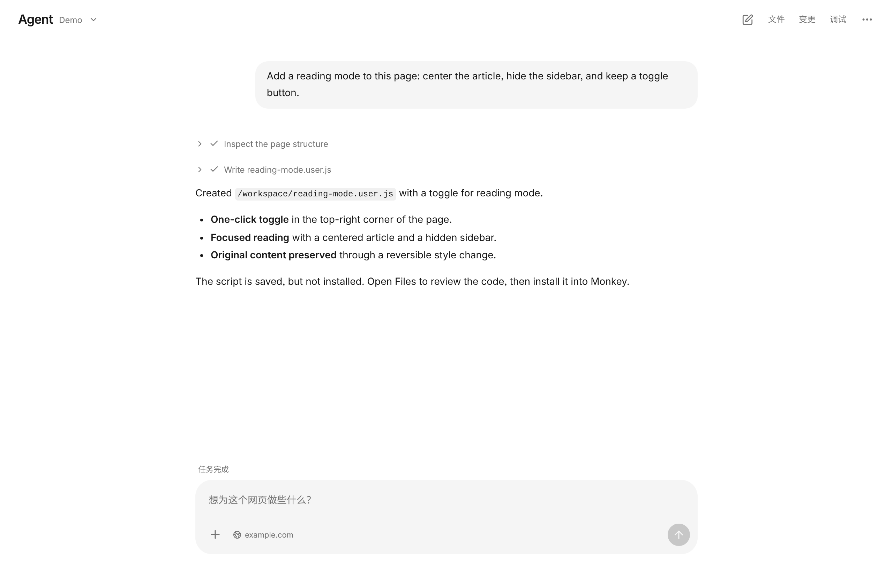
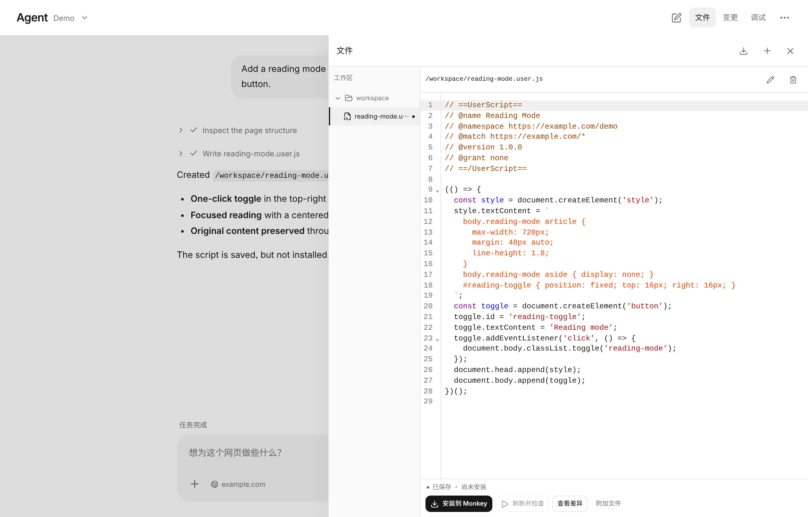
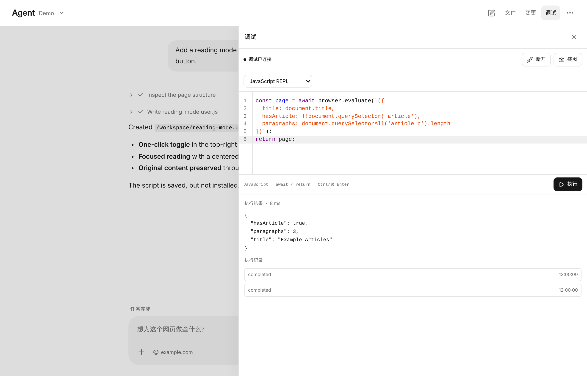

# MonkeyAgent

[English](README.md) | [简体中文](README_CN.md)

在浏览器的开发者工具里，通过对话编写、安装和调试用户脚本。

MonkeyAgent 基于 [Violentmonkey](https://github.com/violentmonkey/violentmonkey)，为 Chromium 增加了 **Agent** 面板。描述你想对网页做的修改，检查生成的代码，安装脚本，再在当前被检查的标签页上验证效果。



_截图来自独立测试扩展中的真实 Agent 界面，使用 `example.com` 上的虚构演示数据。_

## 功能

- **以对话为中心。** 文件、变更和调试各有独立抽屉，需要时再展开。支持浅色和深色主题。
- **编辑与安装用户脚本。** 新建脚本或导入已有脚本，在 CodeMirror 中编辑、查看差异，再安装到 Monkey。修订检查可防止并发编辑时相互覆盖。
- **直接调试被检查的网页。** 执行 JavaScript、检查 DOM 和浏览器事件、读取网络响应、截图，以及验证脚本行为。
- **站点共享工作区，对话独立保存。** 同一可注册域名（eTLD+1）下共享文件和 session 列表；每个 session 保留自己的对话、运行记录和任务基线。
- **持久保存，随时控制。** 重新打开 DevTools 可以恢复文件和消息。可以停止任务、向运行中的任务补充要求，或在保留文件的同时清空对话。

## 开始使用

需要 **Node.js 24+**、`package.json` 指定版本的 pnpm，以及 **Chromium/Chrome 135+**。

在仓库根目录执行：

```sh
pnpm install --frozen-lockfile
pnpm build:mv3
```

1. 打开 `chrome://extensions`，开启**开发者模式**。
2. 选择**加载已解压的扩展程序**，加载构建生成的 `dist-mv3/` 目录。
3. 在扩展详情中开启 **Allow User Scripts / 允许用户脚本**。
4. 打开要修改的网页，打开 DevTools，选择 **Agent**。面板可能位于 DevTools 的更多面板菜单中。
5. 点击左上角的模型选择入口，配置支持流式输出和工具调用的 Chat Completions 兼容地址、模型 ID，以及服务需要的 API Key。Base URL 通常以 `/v1` 结尾，不要附加 `/chat/completions`。
6. 描述想要实现的网页修改，或从**文件**抽屉导入已有脚本。

例如：

> 给当前网页加一个阅读模式：正文居中、隐藏侧栏，并保留一键切换按钮。

Agent 包含在 **MV3 构建**中。普通的 `pnpm build` 仍生成保留上游功能的 MV2 扩展，不包含 Agent 面板。

## 文件与变更

文件抽屉把目录树和编辑器放在一起。文件自动保存，安装则是独立操作。变更抽屉可以将当前文件与本轮任务开始时的修订或最近安装版本对比，也可以恢复基线，生成新的文件修订。



保存文件不会改变网页上正在运行的脚本。需要先安装更新，再刷新网页并检查效果。

## 网页调试

调试抽屉提供 JavaScript REPL、日志、网络事件和截图。手动命令与 Agent 工具使用同一执行队列，浏览器操作始终绑定当前被检查的标签页。



REPL 支持 `await`、显式 `return` 和临时 `state` 对象。例如：

```js
return await browser.evaluate('document.title');
```

## 工作区与数据

工作区按站点的 eTLD+1 隔离，并包含私有后缀规则：`example.com` 的子域共享工作区，不同用户的 `github.io` 站点相互隔离。新建 session 会在当前站点已有工作区中开始一段独立对话。

跨站导航会停止当前任务，切换到目标站点的工作区与 session。返回站点时，恢复当前被检查标签页在该站点最近使用的 session。同一个 session 无法同时在两个 DevTools 窗口打开；不同 session 可以共享工作区文件。

文件、对话和运行记录保存在扩展本地。模型请求发往你配置的服务，可能包含对话、脚本内容和工具读取的网页数据。API Key 与工作区文件分开保存，不会加入模型提示正文。

## 开发

| 命令                      | 用途                                                |
| ------------------------- | --------------------------------------------------- |
| `pnpm dev:mv3`            | 监听扩展与 Agent 源码，重新构建后需要重新加载扩展。 |
| `pnpm agent:dev`          | 本地预览 Agent 界面；真实网页调试需要扩展环境。     |
| `pnpm run ci`             | 运行 lint、单元测试和 Agent 类型检查。              |
| `pnpm agent:test:browser` | 构建 MV3 并运行 Chromium 集成测试。                 |
| `pnpm build`              | 构建保留上游功能的 MV2 扩展。                       |

首次运行浏览器测试前，安装测试浏览器：

```sh
pnpm --filter @monkeyagent/devtools-agent exec playwright install chromium
```

包级开发说明、工具契约和调试方法见 [DevTools Agent 指南](packages/devtools-agent/README.md)与[设计文档](docs/devtools-agent-design.md)。

## 致谢与许可

MonkeyAgent 的用户脚本管理能力来自 Violentmonkey。上游项目介绍见 [Violentmonkey 仓库](https://github.com/violentmonkey/violentmonkey)与[官方网站](https://violentmonkey.github.io/)。

项目使用 [MIT 许可证](LICENSE)。Agent 的第三方依赖及许可证见 [THIRD_PARTY.md](packages/devtools-agent/THIRD_PARTY.md)。
