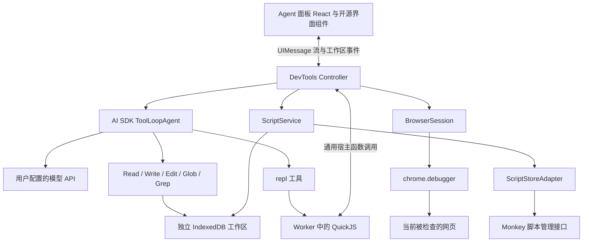

# DevTools Agent 设计与前端实施方案

状态：首版已实现。日期：2026 年 11 月 7 日。面向 Chromium 的 Manifest V3 扩展。构建、使用和验收说明见 [Agent 包文档](../packages/devtools-agent/README.md)。

在 F12 开发者工具中新增 Agent 面板，让用户配置自己的模型 API，通过对话完成 Violentmonkey 脚本的编写、安装、网页验证和修改。Agent 是独立模块：模型调用、运行循环、文件系统、JavaScript REPL 和前端均在自己的代码范围内实现，Monkey 只提供少量脚本管理接口。

实现优先复用开源第三方库和组件。首版采用 AI SDK 的 Agent loop，使用 React、shadcn/ui 的 AI Elements 模式和 CodeMirror 构建界面，通过 `chrome.debugger` 调试当前网页。运行时全部在扩展内，不需要本地服务、虚拟 shell，也不另外连接 CDP WebSocket。

## 模块边界与交付方式

Agent 放在独立的 `packages/devtools-agent/` 包中，拥有自己的依赖、构建、测试、样式和存储。第一版随 Monkey 扩展一起发布；同时提供一个带 MockScriptStore 的最小测试扩展，支持脱离 Monkey 开发和验收。

依赖方向是 Agent 调用抽象的 ScriptStoreAdapter，再由宿主适配到 Monkey。Agent 不导入 Monkey 的业务模块，不读取其数据库，不依赖已有 MCP 连接、日志观察器、设置页或编辑器。

| 范围 | 负责内容 |
| --- | --- |
| Agent 包 | 对话、模型配置、Agent loop、文件工作区、REPL、浏览器调试、运行记录、前端 |
| 浏览器原生 API | DevTools 面板、被检查标签页标识、调试命令与事件、扩展消息 |
| Monkey 适配器 | 列出脚本、读取脚本、保存脚本、启停脚本 |
| 宿主集成 | 合并 manifest 配置、打包 Agent 资源、注册脚本接口和关闭会话后的清理入口 |

Monkey 的改动限于适配器和扩展集成。既有 MCP 功能保持独立。将来拆成单独安装的扩展时，只替换 ScriptStoreAdapter 的传输方式；届时需要另行增加跨扩展消息接收和来源校验。

## 开源组件选型

| 部分 | 选型 | 复用内容 | 自己实现的部分 |
| --- | --- | --- | --- |
| Agent 执行 | AI SDK Core 的 ToolLoopAgent | 模型适配、流式输出、工具调用、多轮循环、停止条件 | 工具定义、任务上下文、会话持久化 |
| 对话状态 | AI SDK UI 的 useChat | UIMessage、流式消息、工具消息状态 | 连接 Controller 的 ChatTransport |
| 前端 | React、TypeScript、Vite | 组件、类型检查、独立多入口构建 | 页面组合和宿主入口 |
| 聊天组件 | shadcn/ui 的 AI Elements 模式 | Chat、Message、Prompt Input、Tool、Task、File Tree、Model Selector | 绑定任务与文件数据 |
| 通用组件 | shadcn/ui | Tabs、Resizable、Sheet、Dialog、Tooltip、Scroll Area、表单 | 布局、主题变量和业务操作 |
| 代码编辑与差异 | CodeMirror 6、@codemirror/merge | JavaScript 编辑、查找、快捷键、差异视图 | 文件版本和脚本绑定状态 |
| JavaScript 执行 | quickjs-emscripten、Web Worker | JS 解释器、Promise、执行中断、内存限制 | fs、browser、scripts 的宿主函数 |
| 持久化 | IndexedDB、idb | 事务、异步存储、Blob 存储 | 文件模型、修订、会话和运行记录 |
| 工具参数 | Zod 与 AI SDK tool | 输入校验、工具 schema | 具体操作定义 |
| 验证 | Vitest、React Testing Library、Playwright | 单元测试、交互测试、扩展浏览器测试 | 真实用户任务和生命周期用例 |

独立前端采用 React，主要是为了直接复用 AI SDK UI 和 shadcn/ui 的配套组件。React 资源只在 Agent 页面加载。Monkey 现有页面使用 Vue，不要求两边共享组件或状态。

AI Elements 当前已提供 shadcn/ui 下的组件组合模式，原独立站公告将在 2026 年 11 月底弃用。新模块从 [shadcn/ui AI Elements](https://ui.shadcn.com/docs/ai-elements) 引入源码和模式，避免以即将弃用的独立站作为新项目入口。组件源码保留上游来源和许可证，业务逻辑放在外层容器中。

AI SDK 使用 [ToolLoopAgent](https://ai-sdk.dev/docs/agents/building-agents) 执行循环，前端沿用 [AI SDK UI](https://ai-sdk.dev/docs/ai-sdk-ui/chatbot) 的消息模型。组件示例中的服务端路由不属于本方案，模型请求由扩展自己的 Controller 发起。实施时锁定兼容的 SDK、组件和 REPL 版本，不追随预发布版本自动升级。

## 运行架构



`devtools.html` 负责创建 F12 的 Agent 面板、取得 `chrome.devtools.inspectedWindow.tabId`，并启动 Controller。Controller 管理整个 DevTools 窗口对应的运行实例；可见面板只负责展示和用户输入。

Controller 持有 AI SDK Agent、浏览器会话、工作区服务和 REPL Worker。面板通过 MessageChannel 与 Controller 交换命令、UIMessage 流和工作区事件。自定义 ChatTransport 只做传输适配，Controller 负责调用 AI SDK 的流转换接口，不另造一套聊天协议或 Agent loop。

每个 DevTools 窗口绑定自己的 tabId。切换浏览器活动标签页不会改变操作目标，任何地方都不通过 getActiveTab 推断调试目标。

Chrome 的 DevTools 页面生命周期与 DevTools 窗口一致，可直接访问扩展 API，见 [DevTools 扩展文档](https://developer.chrome.com/docs/extensions/how-to/devtools/extend-devtools)。Controller 放在该页面，使切换 Elements、Network 和 Agent 时的任务保持连续。关闭 F12 会终止本次运行；首版不提供关闭 F12 后继续执行的后台任务。

## 前端布局与组件

一个 F12 Agent tab 内包含聊天区和工作区，不再另做一个独立后台管理页面。

```text
┌─────────────────────────────────────────────────────────────────────┐
│ Agent   当前网页 example.com   模型选择   新会话   历史   设置        │
├───────────────────────────┬─────────────────────────────────────────┤
│                           │ 文件    变更    调试                     │
│ 对话                      ├───────────┬─────────────────────────────┤
│                           │ main.js   │ main.user.js                │
│ 用户任务                  │ notes.md  │                             │
│ Agent 回复                │           │ 代码编辑器                  │
│ 工具执行卡片              │           │                             │
│ 文件修改卡片              │           │                             │
│ 安装与验证结果            ├───────────┴─────────────────────────────┤
│                           │ 工作区已保存 · 尚未安装                 │
├───────────────────────────┤ 安装到 Monkey   刷新并验证   查看差异    │
│ 当前文件和选中内容附件    ├─────────────────────────────────────────┤
│ 输入需求                  │ 调试抽屉：日志 / 网络 / 截图 / REPL    │
│                       发送│                                         │
└───────────────────────────┴─────────────────────────────────────────┘
```

宽屏采用可拖动分栏，聊天约占 40%，工作区约占 60%，文件树可收起。窄屏改为“对话 / 工作区”切换，保留当前输入、编辑草稿和运行状态。尺寸判断使用面板容器宽度，覆盖 F12 底部停靠、侧边停靠和独立窗口。

### 聊天区

消息列表、输入框、自动滚动和工具展开项采用第三方组件。业务容器负责把 SDK 消息映射为以下内容：

| 内容 | 展示方式 |
| --- | --- |
| 用户需求 | 普通消息，可附文件或编辑器选区 |
| Agent 回复 | 流式文字、代码块和链接 |
| 工具调用 | 工具名、简短说明、耗时、运行状态；展开查看参数和结果 |
| 文件修改 | 文件名和差异入口，点击定位到变更页 |
| 网页截图 | 缩略图，点击查看原图 |
| 脚本安装 | 脚本名、安装结果、当前文件是否还有未安装改动 |
| 任务结束 | 改动、实际验证结果、仍存在的问题 |

不展示模型隐藏推理。工具详情只展示实际执行代码、输入、输出和异常。

空会话提供“为当前网页编写脚本”“修改已有脚本”“检查脚本报错”三个入口。它们生成普通用户消息和必要的附件，不增加三套独立业务流程。

用户上滚阅读时不强制拉回底部，有新内容时展示跳到底部按钮。运行中允许输入补充要求，消息进入队列，在当前工具完成的步骤边界消费。发送队列和正在执行的任务分别显示，停止按钮始终可用。

对话栏提供“清空上下文”：确认后停止当前运行，等待流与工具队列收尾，清除聊天消息、待发送要求及 REPL 临时状态，保留当前文件、脚本绑定和模型设置。重置后的对话使用新的标识并持久化，避免旧流或旧面板重新带回已清空的消息；重新打开面板也不恢复旧对话。“新会话”则用于创建独立工作区。

### 文件与变更

文件树采用 AI Elements File Tree 模式，编辑器采用 CodeMirror。支持新建、打开、重命名、删除工作区文件，以及导入 Monkey 中的已有脚本。首版文件树不实现拖拽移动和大型目录索引。

编辑器内容自动保存到工作区。保存到工作区和安装到 Monkey 是两个独立状态，界面明确区分“已保存”“尚未安装”“已安装”“安装后有修改”“验证通过”和“验证失败”。仅仅成功写入 Monkey 不标记为验证通过。

变更页使用 @codemirror/merge 展示本轮修改。默认比较任务开始时的文件版本与当前版本，可切换到最近一次安装的版本。恢复操作生成新的文件修订；若要恢复网页实际运行的脚本，需要再次安装和刷新。

手动编辑和 Agent 写文件使用相同的 WorkspaceService。编辑器有未提交草稿或版本已改变时保留两份内容并展示冲突，不静默覆盖。用户不需要逐次批准普通文件写入或安装，差异视图用于查看和恢复。

### 调试区与 REPL

调试抽屉提供日志、网络、截图和 REPL。默认折叠底层协议详情，常用结果显示为可筛选的列表，必要时再打开原始 JSON。

REPL 是 JavaScript 编辑器和执行记录，采用 CodeMirror 与现有 Tool 展示组件，不引入终端模拟器。用户可以查看、复制或手动执行 Agent 的调试代码。每次执行显示代码、结果、耗时和异常，使用同一个会话队列，避免人工执行与 Agent 操作交错。

### 设置与前端状态

模型设置使用 Sheet 和表单组件，配置 provider、API base URL、model、API key，以及模型是否支持图片。提供连接检查和清晰的错误反馈。首版支持一类兼容模型 API，通过 AI SDK provider 扩展其他服务。

初始主题跟随 DevTools，允许在 Agent 设置中覆盖。样式和主题变量由独立包管理。界面支持键盘发送、停止、文件切换和可访问的焦点移动。

前端保持单向数据流：AI SDK UI 管理消息和流式状态，React 本地状态管理抽屉、选区和分栏等临时 UI 数据，Controller 管理执行状态，IndexedDB 保存长期数据。UI 不再维护一份可独立修改的运行历史。

## Agent 工具与执行循环

模型使用两类能力：Read / Write / Edit / Glob / Grep 文件工具，以及 JavaScript repl。脚本管理通过 REPL 内的 scripts 对象调用，避免扩展出大量重复工具。

```js
await Read({ file_path: '/workspace/main.user.js', offset: 1, limit: 200 });

await repl({
  code: "return await browser.evaluate('document.title');",
  timeout: 15000,
  description: '检查当前页面标题',
});
```

文件接口参照 Claude Code 的公开参数：Read 的 offset/limit 按行，Write 使用 file_path/content，Edit 使用 old_string/new_string/replace_all。现有文件先读后改，harness 自动跟踪修订并在事务中检查并发，不要求模型传版本号。Glob 使用 picomatch，Grep 使用 RE2JS。旧 files 仅兼容历史记录，不向新请求展示。REPL 的参数为 code/timeout/description，继续用于组合网页调试和脚本安装，不提供 shell。具体契约见 packages/devtools-agent/src/agent/guides/file-tools.md。

工具结果统一携带成功状态、返回值或异常、耗时、工件引用和截断信息。异常进入正常的工具结果通道；图片和大体积文本通过工件引用按需读取。

工具输入及自有 bridge 的选项严格校验，错误不会被隐式改写。REPL 对 undefined 在 JSON 序列化时丢失的情况返回有限数量的诊断 warnings，保持正常的 JavaScript 访问语义。脚本工具返回从宿主快照读取的版本和修订；工作区修订不符、外部变更或禁用时，status 不返回旧验证记录。改进限于通用工具契约、可靠性、诊断和文档；任务选择器、业务断言及判断仍由模型完成，不增加任务模板或特定模型的适配逻辑。

Agent 运行遵循以下顺序：

1. Controller 创建 runId，记录任务开始时的文件修订和当前网页标识。
2. 组装用户需求、显式附件、工作区目录、目标网页信息，以及工具说明。
3. AI SDK 请求模型，流式返回文字或工具调用。
4. 工具经统一队列执行，结果以 SDK 的工具结果格式返回；文件、调试事件和截图进入工作区存储。
5. AI SDK 根据工具结果继续调用模型，直至模型完成、用户停止或达到限制。
6. 最终回复关联修改文件、安装记录和验证结果。

同一会话的工具调用串行执行。首版不引入子 Agent、工具并行写入或多任务调度。初始限制建议为每轮最多 30 个模型步骤、单次 REPL 默认 15 秒且上限 60 秒；达到限制后保留已有结果，由用户决定是否继续。

上下文只自动携带目标信息和文件摘要，文件正文、日志和网络内容按需读取。系统提示要求在目标网页验证关键行为，将网页文本和日志作为待分析的数据，不作为新的工具授权来源。

状态包括 idle、generating、executing、stopping、completed、failed、interrupted 和 limit_reached。工具失败以结构化结果返回，Agent 可以分析和修复；模型连接失败、用户停止和运行限制分别结束当前循环，不自动无限重试。

## REPL 的执行环境与浏览器接口

REPL 执行器采用运行在 Worker 中的 quickjs-emscripten。它支持 Promise、宿主函数和执行中断，见 [项目文档](https://github.com/justjake/quickjs-emscripten)。QuickJS 只负责执行调试代码，真实网页操作仍由 chrome.debugger 完成。

选择独立解释器是为了执行模型生成的 JavaScript、保留显式会话状态，并限制失控代码。MV3 扩展页面不允许直接放开 unsafe-eval，打包的 WASM 则可通过 wasm-unsafe-eval 使用，见 [Chrome CSP 文档](https://developer.chrome.com/docs/extensions/reference/manifest/content-security-policy)。JS、Worker 和 WASM 均随扩展打包。

REPL 注入四个对象：

| 对象 | 能力 |
| --- | --- |
| fs | 通过 WorkspaceService 读写工作区，与标准文件工具使用同一份数据 |
| browser | 当前网页的求值、协议命令、事件、刷新和截图 |
| scripts | 导入已有脚本、安装文件、查询安装状态、启停当前任务脚本 |
| state | 跨次 REPL 执行的临时数据 |

每次执行支持 await，并使用显式 return 返回结果。顶层提供可取消的 sleep(ms)；浏览器导航使用 browser.navigate(url, options)，先注册等待再发送命令。局部 const 和 let 不承诺跨次保留，需要复用的数据放在 state 中。state 只在当前 REPL 实例存活，不做任意 JS 堆持久化；需要跨 F12 关闭恢复的内容写入文件或工作区元数据。

浏览器接口保留少量便捷方法和一个通用协议入口：

```js
await browser.evaluate('document.title'); // 默认当前页面主世界
await browser.send('DOM.getDocument', {}); // 原生 CDP 命令
await browser.contexts();                 // 页面、iframe、Worker 上下文
await browser.events({
  after: 0, methods: ['Runtime.consoleAPICalled'], limit: 50,
});
await browser.waitForEvent('Page.loadEventFired', { timeoutMs: 10000 });
await browser.reload({ waitUntil: 'domcontentloaded' });
await browser.screenshot({ format: 'png' }); // 返回截图工件引用
```

示例：

```js
state.pageTitle = await browser.evaluate('document.title');
const buttons = await browser.evaluate(`
  [...document.querySelectorAll('button')]
    .map(el => ({ text: el.textContent.trim(), disabled: el.disabled }))
`);
return { title: state.pageTitle, buttons };
```

需要断点和单步调试时，直接调用 browser.send 的 Debugger 命令；暂停状态下的局部变量通过 Debugger.evaluateOnCallFrame 读取。点击和键盘操作可使用 Input 命令，首版不实现一套完整的 Puppeteer API。

接口分为自有 bridge 与原生协议两层。evaluate、navigate、reload、events 等是项目定义的便捷方法，可以调整默认值、等待处理、摘要及错误提示；browser.send(method, params, sessionId?) 保留 CDP 的命令名、参数名和原始结果字段，不把 helper 选项混入协议，不为了模型的错误调用修改 CDP。对话工具最外层仍使用统一的结果/错误封装，并保留当前标签页范围、失效句柄和结果大小检查。调试指南通过虚拟文件 `/docs/debugging-workflow.md` 按需提供；轨迹评估见[首份调试轨迹](agent-debug-trace-1-review.md)。

browser.evaluate 中的代码在网页上下文执行，不能直接访问 fs 或 scripts。REPL 顶层代码在 QuickJS 中执行，可以 await browser 方法。上下文之间只传递结构化数据，DOM 节点、函数和对象句柄不直接跨运行时共享。

BrowserSession 管理 attach、sendCommand、onEvent、onDetach 和子会话。iframe、Worker 使用各自的执行上下文或 sessionId。页面导航、刷新和 frame 替换会使旧的对象句柄和调用栈失效，接口返回 context_changed 并清理失效引用；state 中的普通数据仍然保留。

chrome.debugger 已提供所需的 Runtime、DOM、Input、Page、Network、Fetch 和 Debugger 等协议域，见 [开放范围](https://developer.chrome.com/docs/extensions/reference/api/debugger#restricted-domains)。调试附加后启用 Runtime、Log、Page 和 Network；其他域按需启用，Debugger 暂停和请求拦截等状态在会话结束时清理。

这里的通道只有 Worker 与 Controller 之间的通用宿主函数调用。DOM 查询、点击、日志和网络请求不再分别开发 content script bridge。

## 文件系统与数据保存

工作区采用带路径的异步文件 API，底层使用 IndexedDB 和 idb。首版不要求 Node fs 兼容，因此不用引入 shell 或完整的 Node 文件系统模拟。

```text
/workspace/
  main.user.js
  notes.md
/artifacts/
  page-snapshot.json
  screenshot-001.png
/docs/
  browser-api.md
  script-api.md
```

workspace 是用户和 Agent 的可编辑文件，artifacts 保存调试产物，docs 提供只读的工具用法。图片以 Blob 保存并由工件服务读取，文本工具返回文件说明或引用，不把 base64 填进日志和模型文本上下文。支持图片的模型通过 SDK 的图片内容接收需要查看的截图。

所有文件操作使用统一的路径规范化。每个文件有 revision；edit 和覆盖已有文件的 write 携带预期修订，并在同一 IndexedDB 事务中比较和更新。版本不符返回 conflict，要求重新读取。首次创建允许不带已有修订，删除也进行版本检查。

IndexedDB 使用 Agent 自己的数据库名和 schema 迁移，保存以下数据：

| 数据 | 内容 |
| --- | --- |
| workspaces | 工作区、目标信息、文件与脚本 ID 绑定 |
| files 与 revisions | 文件正文、修订、时间和本轮变更基线 |
| conversations 与 runs | SDK 消息、执行状态、用户队列 |
| operations | 操作 ID、开始、结束、失败和结果未知状态 |
| artifacts | 截图、DOM 快照和按需保存的调试结果 |

浏览器事件使用有界缓冲，首版建议按每个会话 2000 条或约 2 MiB 控制，先达到的限制生效。日志和网络列表分页读取，请求或响应正文按需获取并设单次大小限制；需要长期保留的结果转成工作区工件。

API key 使用 Agent 独立的扩展配置键保存，不进入工作区、提示词、REPL、会话导出或 Monkey 通用设置导出。独立数据库和配置命名是模块边界，不把同一扩展内的代码视为不同权限主体。

## Monkey 的最小接口

Agent 定义自己的 ScriptStoreAdapter，Monkey 实现该契约。接口返回普通 DTO，不能把 Monkey 内部数据库对象暴露给 Agent。

```ts
interface ScriptSummary {
  id: string;
  name: string;
  enabled: boolean;
}

interface ScriptSnapshot extends ScriptSummary {
  code: string;
  revision: string;
}

interface ScriptStoreAdapter {
  list(): Promise<ScriptSummary[]>;
  get(id: string): Promise<ScriptSnapshot>;
  save(input: { id?: string; code: string }): Promise<ScriptSnapshot>;
  setEnabled(id: string, enabled: boolean): Promise<void>;
}
```

id 对 Agent 是不透明字符串，适配器负责转换为 Monkey 的标识。revision 可以由代码和启用状态生成，供安装前检查变化。首版不要求 Monkey 支持按 URL 过滤，Agent 通过搜索或用户选择导入目标脚本。

Monkey 侧保存仍走自己的元数据解析、安装和依赖处理流程。没有 id 时必须显式创建新脚本，同名冲突返回错误；不能因 namespace 和 name 相同而静默覆盖已有脚本。保存接口不负责刷新标签页。

当前仓库已有 [GetScriptCode 和 ParseScript](../src/background/utils/db.js) 等入口。适配器可在后台调用这些能力，内部实现细节只存在于 Monkey 侧。当前 [reloadTabForScript](../src/background/utils/tabs.js) 按活动标签页刷新；Agent 通过自己的 BrowserSession 刷新绑定的被检查页面。

Agent 的 ScriptService 在这四个接口之上实现：

```ts
scripts.list();
scripts.import(id, path);
scripts.apply(path);
scripts.status(path);
scripts.setEnabled(path, enabled);
```

import 将脚本代码和基线修订保存到工作区。apply 读取文件，通过适配器保存，并记录文件修订与返回的脚本 ID。更新已有脚本前重读 Monkey 版本；发现相对导入基线的外部修改时停止覆盖并展示冲突。四方法接口的前置重读属于冲突检测，不能保证与 Monkey 自带编辑器的写入原子互斥；若后续需要严格的并发更新保证，再为宿主接口增加原子版本检查。

Monkey 接口通过独立命名的扩展内部消息通道提供，只接收 Agent 扩展页的请求，不挂到网页全局或 userscript 的可调用接口上。MockScriptStore 实现同一契约，用于前端开发和独立验证。

## 编写安装和验证流程

一次典型任务是“为当前网站增加一个筛选按钮”：

1. Agent 用 browser.evaluate 或 DOM 协议检查页面结构，必要时查看截图。
2. Write / Edit 工具创建或修改 main.user.js，界面显示文件改动和未安装状态。
3. scripts.apply 将文件交给 Monkey 安装，保存工作区文件与脚本的对应关系。
4. 查询安装后的启用状态，必要时通过 setEnabled 启用当前任务脚本。
5. browser.reload 刷新被检查的标签页，等待新文档达到指定加载状态。
6. 通过 DOM、实际交互、日志和截图验证按钮及筛选行为；存在问题则继续修改。
7. 最终回复列出安装脚本、修改文件、已完成的验证和剩余问题。

```js
const installed = await scripts.apply('/workspace/main.user.js');
await scripts.setEnabled('/workspace/main.user.js', true);
await browser.reload({ waitUntil: 'domcontentloaded' });
const verification = await browser.evaluate(`
  ({ buttonPresent: !!document.querySelector('[data-agent-filter]') })
`);
return { installed, verification };
```

安装后的页面必须经过 Monkey 的实际注入流程，以覆盖 @match、@grant、@run-at 和 GM API 的真实行为。直接在 browser.evaluate 中执行一份脚本文本不能代替安装验证。上例只验证按钮存在，筛选行为还需实际操作后检查结果。

文件恢复、Monkey 脚本恢复和网页恢复分别记录。回退代码只能恢复脚本内容，不能撤销脚本已经对网站或远端服务产生的动作。

## 停止恢复与会话生命周期

停止按钮同时中止模型请求、取消尚未开始的工具，并通知 REPL 停止调度。QuickJS 设置计算中断和内存限制，失去响应时销毁 Worker。已经发出的网页操作、脚本保存和网络请求不因 Worker 被销毁而回滚。

每个工具调用携带 operationId，调用前记录开始状态，完成后保存结果。页面刷新、扩展重载或进程结束造成返回结果不确定时，操作标记为 unknown。下次继续先读取文件、脚本或页面确认状态，不自动重放创建脚本、点击提交等有副作用的调用。

生命周期采用以下规则：

| 场景 | 行为 |
| --- | --- |
| 切换 F12 面板 | Controller 和 Worker 继续运行，面板重新显示时同步快照 |
| 网页刷新或导航 | 保留工作区和任务，更新执行上下文，废弃旧对象句柄 |
| 用户取消浏览器调试 | 标记断开并停止依赖该连接的运行；显式重连后再继续 |
| 关闭 F12 | 停止当前运行，保存已有文件和记录，释放调试会话 |
| 重新打开 F12 | 恢复历史和工作区，新建调试会话，不自动重放上次工具 |
| 多个 DevTools 窗口 | 按 tabId 隔离 BrowserSession，工作区写入仍检查修订 |

Agent 自带一个很小的后台生命周期模块。DevTools 页面建立命名 Port，后台在 Port 断开时清理该会话的调试连接，避免仅依赖页面 unload。该模块与 Monkey 脚本适配器分开，不承载 Agent loop 或模型请求。

## 工程目录与扩展集成

```text
packages/devtools-agent/
  package.json
  vite.config.ts
  src/
    devtools/          DevTools 入口与 Controller
    panel/             React 页面和业务容器
    components/        引入的开源组件及来源说明
    agent/             AI SDK 配置、文件工具、REPL 与内置 Markdown 指南
    workspace/         IndexedDB 文件和修订服务
    repl/              QuickJS Worker 与宿主函数
    browser/           chrome.debugger 会话和事件
    scripts/           ScriptStoreAdapter 契约与 ScriptService
    model/             provider 配置与 API 连接
    background/        Port 断开与调试连接清理
    protocol/          内部消息类型和 DTO
  fixtures/extension/  MockScriptStore 测试扩展
  test/

src/background/utils/agent-script-api.js  Monkey 侧适配器
```

将 packages/devtools-agent 加入仓库现有 pnpm workspace。Vite 独立产出 devtools、panel、Worker、WASM 和后台清理入口；宿主构建复制到扩展 agent 目录。Agent 不使用 Monkey 的 webpack 全局变量、browser 包装器、options 存储或 Vue 组件。

首版 Chrome MV3 集成包括 devtools_page、debugger 权限、允许打包 WASM 的 CSP，以及后台模块和脚本接口注册。配置按构建目标生成，不能向 Firefox 构建无条件添加 Chrome 专用功能。模块内部直接使用 chrome 命名空间，并包装所用 API 的 Promise 和回调差异。

前端组件和 Worker 按需加载，编辑器、差异组件、代码高亮和 QuickJS 不进入 Monkey 普通页面的公共 bundle。依赖、字体和 WASM 随包发布，运行时不从 CDN 拉取代码。

普通网页中的 UI 开发可使用 Vite 和 Mock adapter。真实扩展调试使用本地构建产物与 watch，避免依赖远程开发脚本加载。生产使用不需要 Vite 服务或其他本地进程。

## 实施顺序与验收

| 阶段 | 交付 | 验收条件 |
| --- | --- | --- |
| 1 独立骨架与运行验证 | 独立包、测试扩展、F12 入口、React 组件布局、QuickJS 和原生调试连接 | 不加载 Monkey 也能打开面板；F12 打开时可求值、截图；Worker 可执行异步宿主调用并中断死循环 |
| 2 对话与工作区 | AI SDK loop、模型设置、聊天组件、标准文件工具、文件树、编辑器和持久化 | 用户可对话创建和修改脚本；停止有效；关闭 F12 后文件和消息可恢复 |
| 3 浏览器 REPL | fs 与 browser 对象、事件缓冲、上下文、日志、截图和调试抽屉 | Agent 可组合多步网页操作；刷新后能继续；错误结果可进入下一轮推理 |
| 4 Monkey 接入 | 四方法适配器、导入、安装、启停、脚本与文件绑定 | 真实完成编写、安装、刷新、验证、修复；同名创建不覆盖；目标标签页正确 |
| 5 完整交互与回归 | 变更页、恢复、消息队列、窄屏、错误和重连状态 | 人工编辑冲突不丢内容；面板切换不丢任务；异常中断不重放副作用 |

第一阶段用目标 Chrome 版本实测 F12 与调试附加的共存，包括先打开 F12 再附加、切换内置面板、停靠方式变化和关闭后的清理。官方多客户端说明与 debugger API 中的断开描述存在差异，因此该项是进入完整实现前的运行验证，不以文档推断代替。[多客户端说明](https://developer.chrome.com/blog/new-in-devtools-63#multi-client-remote-debugging-support)、[断开事件说明](https://developer.chrome.com/docs/extensions/reference/api/debugger#event-onDetach)。

关键测试覆盖文件修订冲突、工具顺序、停止和超时、SDK 消息恢复、截图输出、主页面与 iframe 上下文、导航后句柄失效，以及一份使用 GM API 和 document-start 的真实脚本。浏览器集成测试必须加载实际构建的扩展；Mock adapter 和普通 UI 预览不能代替这部分验证。

首版范围为单 Agent、单个当前网页、JavaScript userscript、文件编辑和真实浏览器验证。多 Agent、npm 安装、Node 运行时、虚拟终端、远程机器控制和 Firefox 调试后端不进入首版。

## 参考实现与资料

- [AI SDK Agent loop](https://ai-sdk.dev/docs/agents/building-agents) 与 [AI SDK UI](https://ai-sdk.dev/docs/ai-sdk-ui/chatbot)。
- [shadcn/ui AI Elements](https://ui.shadcn.com/docs/ai-elements) 与 [通用组件](https://ui.shadcn.com/docs/components)。
- [CodeMirror 项目与包入口](https://code.haverbeke.berlin/codemirror/dev) 与 [差异组件](https://code.haverbeke.berlin/codemirror/merge)。
- [quickjs-emscripten](https://github.com/justjake/quickjs-emscripten) 与 [idb](https://github.com/jakearchibald/idb)。
- [Chrome DevTools 扩展](https://developer.chrome.com/docs/extensions/how-to/devtools/extend-devtools)、[debugger API](https://developer.chrome.com/docs/extensions/reference/api/debugger) 与 [扩展 CSP](https://developer.chrome.com/docs/extensions/reference/manifest/content-security-policy)。
- [BrowserTools MCP 的 DevTools 调试接入](https://github.com/AgentDeskAI/browser-tools-mcp/blob/main/chrome-extension/devtools.js)，仅参考浏览器端连接方式。
